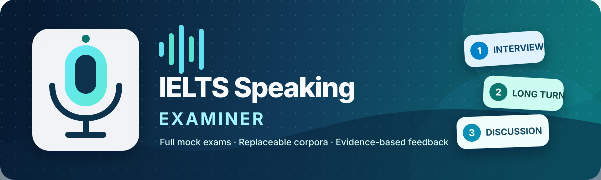
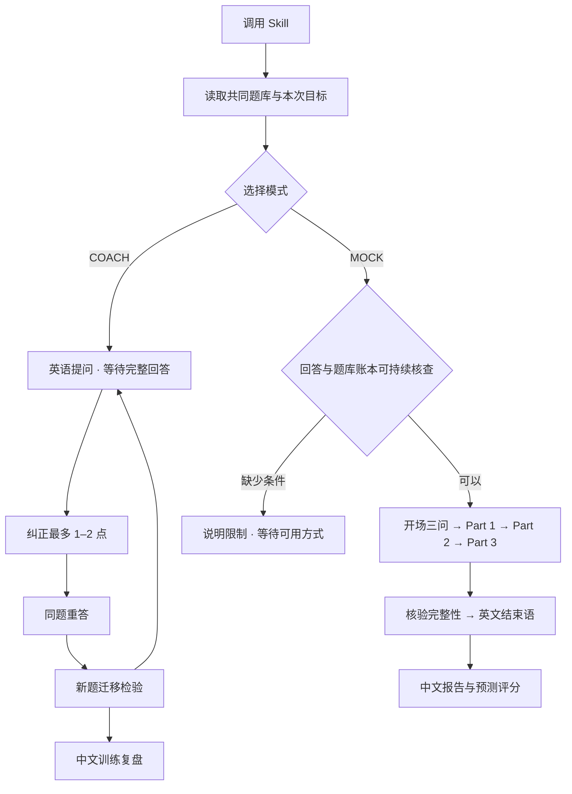

<p align="center">
  
</p>

<p align="center">
  
  
  
  
</p>

<p align="center">
  <strong>把修正后的表达说出来，把完整考试走下来。</strong><br/>
  一个 Skill，两种模式，同一套可更新题库。
</p>

<p align="center">
  <a href="#一分钟开始">一分钟开始</a> ·
  <a href="#语音陪练">语音陪练</a> ·
  <a href="#完整模考">完整模考</a> ·
  <a href="#安装">安装</a> ·
  <a href="#共用题库与练习历史">题库与历史</a> ·
  <a href="./docs/GITHUB_PUBLISHING_GUIDE.md">GitHub 发布教程</a>
</p>

---

## 它是什么

**IELTS Speaking Examiner** 是面向支持本地 Skills 的 ChatGPT/Codex 宿主的可复用口语训练 Skill。日常用 **COACH 语音陪练**练习、纠正、重答；定期用 **MOCK 完整模考**检验未经提示的表现。两种模式读取同一份安装包题库，练习记录与题库、规则分开保存。

| | 🎙️ 语音陪练 · COACH | 📝 完整模考 · MOCK |
| --- | --- | --- |
| 适用场景 | 日常提升与薄弱项复习 | 检验整场独立作答能力 |
| 对话方式 | 连续 Voice 或逐条回答 | 能持续接收回答并维护题库账本的环境 |
| 节奏 | 回答 → 纠正 → 重答 → 新题迁移 | 三问开场 → Part 1 → Part 2 → Part 3 |
| 题量 | 按训练目标与时间安排 | Part 1 + Part 3 恰好 11 个有效主问题 |
| 反馈 | 每轮最多 1–2 点，不每题打分 | 英文结束语后统一点评、估分 |
| 收尾 | 主要错误、2–3 个表达、最佳表达、复习目标 | 分 Part 诊断、预测总分、表达升级与复习任务 |

**题库是随包安装的独立文件。** 更新季度不必改写教练或考官规则；换电脑时复制完整安装包，不必在每次练习前重新上传同一份题库。

## 一分钟开始

在能读取已安装 Skill 的任务中，选择一种方式：

**开始语音陪练**

```text
$ielts-speaking-examiner 使用当前题库，进入语音陪练模式，练习 Part 1，重点改善答案展开。一次一题，纠正后让我重答，再用新题检验。
```

先让 Skill 加载题库并确定本次目标，然后使用连续 Voice；也可输入文字或用听写逐条发送。已经指定的话题、Part 和目标不会再次询问。

**开始完整模考**

```text
$ielts-speaking-examiner 使用当前默认题库，开始完整口语模拟。考试全程英语，结束后用中文详细点评。
```

Skill 会先检查能否持续接收本次所有回答、读取所选题目并维护计数。条件不足时会说明具体缺口，保留模考请求，不会自行换成陪练。普通任务中逐条提交答案，是一种便于核对记录的使用方式。

> 明确说“陪练、纠正后重答”进入 COACH；说“完整模考、考试”进入 MOCK。单独调用 Skill 仍默认 MOCK，兼容原来的用法。只说“练口语”等含糊请求时，会确认一次模式。



## 安装

### 方法一：使用 ZIP 安装包

1. 下载并解压 `ielts-speaking-examiner.zip`。
2. 确认解压后的 `ielts-speaking-examiner/` 中直接包含 `SKILL.md`、`references/`、`agents/` 和 `corpora/`。
3. 将整个文件夹复制到用户级 Skill 目录：

| 系统 | 用户级目录 |
| --- | --- |
| Windows | `%USERPROFILE%\.agents\skills\ielts-speaking-examiner` |
| macOS / Linux | `~/.agents/skills/ielts-speaking-examiner` |

4. 重新打开任务；未显示新版时重启宿主应用，再输入 `$ielts-speaking-examiner` 调用。

也可以安装到某个项目的 `.agents/skills/ielts-speaking-examiner`。请避免同时保留同名的全局与项目副本，以免加载旧规则。Skill 不需要 API 密钥、录音软件或额外本地运行环境；宿主仍须支持读取本地 Skills 和文件。

### 方法二：从 GitHub 克隆

```bash
git clone https://github.com/Errriclin/ielts-speaking-examiner.git
```

将包含 `SKILL.md` 的 Skill 根目录放入 `~/.agents/skills/ielts-speaking-examiner`。Windows 中的 `~` 对应当前用户目录；若仓库包含 `skills/ielts-speaking-examiner/` 子目录，应复制该子目录，而不是再套一层整个工作仓库。

> 更新安装包会更新规则和随包题库。个人练习历史应保存在项目或另行指定的文件中，不放进 Skill 安装目录。已经打开的旧对话可能保留旧版指令，更新后请使用新任务验证。

## 语音陪练

### 一次练好一个目标

开始时确定话题、Part 和一个主要目标，例如：展开理由、过去时准确性、减少词汇重复。若你已经指定，直接采用；没有指定时用简短确认或可更改的默认值开始，不连续追问一长串设置。

练习以英语进行，一次只问一道题，并等待完整回答。默认不套用模考的三问开场、不强制 11 题，也不把几道训练题包装成完整考试。

### 回答 → 纠正 → 重答 → 迁移

1. **第一次回答**：不在说话中途纠正，也不提前给范文。
2. **短反馈**：引用你实际说过的内容，最多指出 1–2 个最有影响的问题，给出简短、可复用的修改。
3. **同题重答**：让你重新组织答案，把修改真正说出来。
4. **新题迁移**：从共同题库选择相关但不同的问题，检查你能否主动运用刚才的改进。

每轮不打分。每次训练只重点积累 2–3 个表达，可比较更自然的说法、日常常用说法与适合 Band 7+ 的表达；不会为了显得高级而堆砌生词。Part 2 陪练同样先给完整题卡，等长答结束后反馈。

### 结束训练

说“结束训练”后，默认用中文给出：

- 本次反复出现或影响最大的错误：最多 5 个，证据不足时不凑数；
- 2–3 个值得积累的表达及简短用法；
- 今天最好的实际表达；
- 下一次优先复习的一个目标与可执行练习。

连续 Voice 可以用于陪练；语音标签本身不是拒绝条件。如果宿主只能提供转写，就只评价文字能够支持的内容。无法读取题库或无法保留前后回答时，会说明限制，不会伪称题库已加载或重答已改善。

## 完整模考

### 开场与考试规则

通过能力检查后，第一句固定为：

> Hello. This is the IELTS Speaking test. I’ll be your examiner today. What’s your name?

随后依次询问 **“Where are you from?”** 和 **“Do you work, or are you a student?”**。三问分别等待回答，全部完成后才进入 Part 1；它们不计入正式题量。

| 阶段 | 要求 |
| --- | --- |
| Opening | 独立三问，逐问等待回答 |
| Part 1 | 5 或 6 个有效正式题库主问题，约 4–5 分钟 |
| Part 2 | 完整 cue card，准备 1 分钟，长答 1–2 分钟 |
| Part 3 | 与 Part 2 关联的 6 或 5 个有效正式主问题，约 4–5 分钟 |
| Closing | 核验完成情况，英文结束语之后才进入点评 |

默认分配为 `6 + 5`，也支持 `5 + 6`；正式开考前固定分配。重复、澄清、追问、换题指令、Part 2 收尾问题及被撤销题目都不计入这 11 题。考试中不纠错、不提供范文，所有提问、转场、换题确认都使用英语。

### 连续与分段方式

能力检查针对的是**实际可用的回答记录与状态**：是否能获得每条答案、核对题库题号、维护计数并控制转场。仅凭 Voice 名称、目录名或消息包装，不自动判为不可用。

如果只能收到偶发后台任务或尾部转录，无法持续跟踪完整记录，就不能宣称严格模考已经完成。Skill 不会擅自降级为 COACH。需要时可改用普通任务逐条发送，或在能取得完整记录的条件下显式选择分段模考：

```text
$ielts-speaking-examiner 使用当前题库，进行分段完整模考。每个 Part 结束后核对题号和有效回答数，考试中不要纠错，全部完成后再评分。
```

分段时仍保留开场与全部 Parts；阶段核对只核验进度，不提供表现反馈。可使用英文的题号提示，例如 “Question three of six”。短测成功、阶段核对或文档检查，都不代表连续 Voice 的完整流程已通过实际验收。

### 考中换题与模式切换

- **换一道**：撤销当前待答题，不增加计数，并选择未用题补足。
- **这套考过了，换一套**：先验证新的完整题组，再从 Part 1 重建正式考试记录；已完成的开场三问不必重复。
- **更换 Part 2**：同步更换关联 Part 3 题组，重新完成新的 Part 2。
- **从陪练切换为模考**：创建独立尝试，完成新的开场与整场流程；陪练修改后的答案不能充作模考证据。
- **提前结束**：明确标注未完成，不能冒充完整考试。

同一尝试中已问、撤销或明确标为做过的题目不会再次抽取。跨会话去重需要能够读取之前的练习历史，不能凭空声称“从未考过”。

## 评分与反馈

完整模考结束后，报告包括：

1. **整场模拟结果**：预计 Speaking Band、证据来源和限制。
2. **Part 1/2/3 分项诊断**：按实际可用的官方评分维度点评，引用本次回答。
3. **最大问题与下一步训练**：每个 Part 给出明确重点。
4. **表达升级库**：只选 2–3 个表达，避免信息过载。
5. **全场复盘**：最多 5 个主要错误、最佳表达、建议复习内容。

Part 1/2/3 的数字是**训练诊断分**；IELTS 官方最终评分基于整场表现，不公布三个 Part 的独立成绩，因此不会简单平均三个 Part 得出总分。

Pronunciation 只根据评分者实际取得的音频证据评估。只有转写时，不把它列为评分项，也不从拼写猜测发音；仍给出 **预测口语总分（限三项文字证据）**，依据文字可支持的 Fluency & Coherence、Lexical Resource、Grammatical Range & Accuracy，并说明这不是官方四项完整计算。停顿、节奏等没有声音证据的表现同样不能凭空推测。

陪练默认不每题打分；从陪练得到的修正答案、示范或其他会话回答，不进入正式模考的评分证据。

## 共用题库与练习历史

### 题库可替换，两个模式共用

```text
corpora/
├── index.json                    # 唯一活动题库入口：版本、范围、列表
└── <corpus-id>/
    ├── manifest.json             # 来源、数量、范围和审核标记
    ├── questions.json            # 两种模式共用的 Part 1/2/3 数据
    ├── questions.md              # 人类可读版本
    ├── IMPORT_REPORT.md          # 导入与校验报告
    └── source.pdf                # 可选；仅在拥有分发权时公开
```

```text
$ielts-speaking-examiner 列出已安装题库，告诉我当前活动版本和默认范围。
```

```text
$ielts-speaking-examiner 把我提供的新季度题库导入为独立版本，校验 Part 1/2/3 后设为当前题库；先不要开始练习。
```

导入保留题目原文、页码与 Part 2/3 关联，排除目录重复、广告和范文；残缺材料标记审核状态。切换前需校验可用题量与完整模考所需的关联题组。每次尝试固定开始时的题库版本，途中切换不悄悄改写已有题目。

详细数据约定见 [`references/corpora.md`](./references/corpora.md)。

### 历史属于你，不进入安装包

默认只使用当前会话内的记录。要持久保存，可明确说：

```text
请把本次练习历史保存到当前项目的 practice-data/history.jsonl，之后用它避开近期模考题，并安排薄弱项复习。
```

记录包含模式、题库版本、题目编号、练习情况与复习要点，陪练与模考分别标记。完整模考优先未练题；陪练允许主动复习，重复出现时说明这是复习。

历史不会写入 Skill 安装目录，也不随 ZIP 分发。跨项目须显式指定同一份可访问的历史文件；换设备要另行迁移历史，不会自动云同步。文件不可读时会说明去重范围，不假装记得其他对话。详细规则见 [`references/history.md`](./references/history.md)。

## 项目结构

```text
ielts-speaking-examiner/
├── SKILL.md                       # 入口、模式路由与共用约束
├── README.md
├── agents/openai.yaml             # 界面信息与默认提示词
├── references/
│   ├── coaching.md                # 语音陪练循环与收尾
│   ├── exam.md                    # 完整模考流程和账本
│   ├── assessment.md              # 模考评分与反馈
│   ├── history.md                 # 独立历史与去重/复习
│   └── corpora.md                 # 共同题库管理
├── corpora/                       # 可替换的共同题库
├── assets/readme-banner.svg
└── docs/GITHUB_PUBLISHING_GUIDE.md
```

个人历史在安装目录之外，例如当前项目的 `practice-data/history.jsonl`。

## 设计原则与已知限制

- **模式明确**：陪练及时纠正，模考结束后纠正；不把两种评分证据混在一起。
- **一次一问**：除完整 cue card 外，一次提出一个问题，等待完整回答。
- **能力依据事实**：能否严格模考取决于完整记录和账本，不凭 Voice 标签猜测。
- **题库与规则分开**：两种模式使用同一份数据，题库文字不能改写角色与评分规则。
- **反馈可追溯**：只引用实际回答，不虚构错误、改进、发音或计时结果。
- **规则不等于运行时保证**：本项目是指令型 Skill。连续语音的上下文、任务委派和自动计时由宿主决定；仍需实际对话验收。
- **单一角色入口**：同一尝试不要同时启用另一套 IELTS 考官插件，以免规则冲突。
- **不额外录音**：Skill 不创建录音文件；应用自身的数据处理与保留设置仍然适用。
- **评分用于训练**：不是 IELTS 官方成绩，也不把有限转写证据包装成完整听音评分。

有关宿主能力，参见 [Build skills](https://learn.chatgpt.com/docs/build-skills)、[ChatGPT Voice](https://learn.chatgpt.com/docs/features/voice) 和 [GPT-Live](https://developers.openai.com/api/docs/guides/live)。本地安装不会自动让其他客户端获得文件；实际使用以宿主能读取的规则与资料为准。

## 开源与贡献

欢迎贡献更清晰的模式规则、有页码和授权的题库数据、可复现的流程问题，以及不依赖单一操作系统的安装说明。

提交题库前，请确认有权公开传播原文及整理版本。代码或 Skill 指令的开源许可证不会自动赋予第三方题库、出版物或 PDF 的再分发权。完整步骤见 [GitHub 开源发布教程](./docs/GITHUB_PUBLISHING_GUIDE.md)。

## 声明

本项目是独立的学习与模拟工具，与 IELTS、British Council、IDP、Cambridge University Press & Assessment 或 OpenAI 没有关联、授权或背书关系。IELTS 相关商标归其各自权利人所有。

评分参考：

- [IELTS Speaking format](https://ielts.org/take-a-test/test-types/ielts-general-training-test/ielts-general-training-format-speaking)
- [IELTS Speaking band descriptors](https://ielts.org/cdn/ielts-guides/ielts-speaking-band-descriptors.pdf)

## License

本项目的 Skill 指令、说明文档和原创图形采用 [MIT License](./LICENSE)。题库数据、第三方 PDF、出版物内容和商标不因仓库采用 MIT License 而自动获得相同授权；它们仍受各自权利声明约束。
